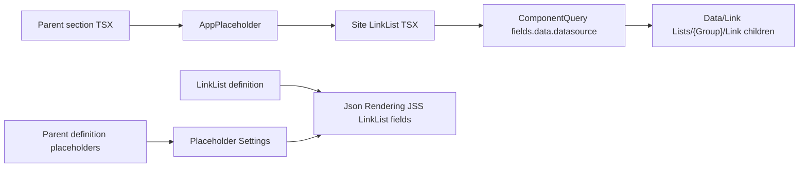

# LinkList placeholder + rendering codegen

## Canonical Sitecore reference (retrieved live)

**Path:** `/sitecore/layout/Renderings/Feature/JSS Experience Accelerator/Navigation/LinkList`  
**Item ID:** `{4956263D-1195-4D6E-931B-800EA625FF6F}`  
**Template:** Json Rendering `{04646A89-996F-4EE7-878A-FFDBF1F0EF0D}`  
**YAML cross-check:** [`authoring/items/bq-demo/sai/Featurerenderings/Feature/JSS Experience Accelerator/Navigation/LinkList.yml`](authoring/items/bq-demo/sai/Featurerenderings/Feature/JSS%20Experience%20Accelerator/Navigation/LinkList.yml)

Authoring GraphQL (`bqAuthoring`) was used for this plan. Do **not** use classic SXA `/…/Experience Accelerator/Navigation/Link List` (Controller rendering). Bake the values below into LinkList rendering emit; do not re-fetch on every generate run.

### Dedicated fields to set on project LinkList Json Renderings

| Field | Exact value from JSS LinkList | Notes |
|---|---|---|
| **componentName** | *(site-specific kebab)* | Platform item = `LinkList`; ours = branded kebab matching TSX |
| **ComponentQuery** | Full `LinkListQuery` below | Same text as `PLATFORM_LINK_LIST_COMPONENT_GQL` today |
| **Datasource Location** | `query:$site/*[@@name='Data']/*[@@templatename='Link List Folder']\|query:$sharedSites/*[@@name='Data']/*[@@templatename='Link List Folder']` | Use **templatename**, not `@@name='Link Lists'` |
| **Datasource Template** | `/sitecore/templates/Branches/Feature/JSS Experience Accelerator/Navigation/Link List` | **Branch path**, not group GUID `{60C9AC62-…}` |
| **Parameters Template** | `{33C9207E-3B04-4606-8EF5-4CA99A97C776}` | JSS Navigation LinkList params (not project `* Parameters`) |
| **OtherProperties** | `IsRenderingsWithDynamicPlaceholders=true` | Already BQ default |
| **Open Properties after Add** | `0` | Already BQ |
| **AddFieldEditorButton** | `0` | Not written by current apply — add for LinkList |
| **Page Editor Buttons** | `{31A3A929-C599-4DD3-91A6-F4A9487CC8B7}\|{587F8FBD-E38F-4E2B-8DE4-1F474D9DDD00}` | core Insert + Manage items — **not** in current apply; required for LinkList parity |
| **__Icon** | `SXA_MDI/16x16/Link-List.png` | Prefer this for LinkList packages |
| **Rendering Contents Resolver** | *(empty)* | Must stay empty — do not copy classic SXA resolver |
| **Placeholders** | *(empty)* | LinkList itself has no nested placeholders |
| **Compatible Renderings** | *(empty)* | |
| **RenderingCssClass** | *(empty)* | Do not set `link-list` from classic SXA |
| **Controller / Controller Action** | N/A | Not on Json Rendering template |

**ComponentQuery (full, from CM):**

```graphql
query LinkListQuery($datasource: String!, $language: String!) {
  datasource: item(path: $datasource, language: $language) {
    children(first: 90) {
      results {
        field(name: "Link") {
          link: jsonValue
        }
      }
    }
    field(name: "Title") {
      title: jsonValue
    }
  }
}
```

**Apply gap vs today’s BQ Json Rendering:** [`rendering.ts`](bq/tools/definitions/apply/rendering.ts) / [`component-to-rendering.ts`](bq/tools/definitions/apply/component-to-rendering.ts) already cover componentName, ComponentQuery, DS location/template, OtherProperties, Open Properties, Parameters Template, icon. For LinkList packages they must emit the **JSS values above**, and additionally write **Page Editor Buttons** + **AddFieldEditorButton=0**. Leave Rendering Contents Resolver unset/empty.

**Dual-write / JSON bags:** Flat link lists are **Link List items only**. No dual-write. No Multi-LineText JSON `{ text, url }[]` field on the parent. FE reads links only via the LinkList ComponentQuery datasource.

## Target architecture



Canonical UI example: replace an inline link map (old [`menzis-footer-info-links.client.tsx`](bq/src/components/menzis-nl/MenzisFooterInfoLinks/menzis-footer-info-links.client.tsx) nav) with `AppPlaceholder`, and render that list in a **single** LinkList component — not N× single-link renderings ([`MenzisFooterLegalLink`](bq/src/components/menzis-nl/MenzisFooterLegalLink/)), and not `JSON.parse` of a bag field.

Field shape for LinkList TSX (inline in the same file; no `sxa-link-list.props` import) — from kit [`LinkList.tsx`](examples/kit-nextjs-product-listing/src/components/sxa/LinkList.tsx) / [`sxa-link-list.props.ts`](examples/kit-nextjs-article-starter/src/components/sxa/sxa-link-list.props.ts):

```ts
fields?.data?.datasource?.children?.results[] → field.link (LinkField)
fields?.data?.datasource?.field?.title (TextField) // optional; omit in UI if design has no title
```

Markup/classes stay section-specific.

## What already exists

- Platform Link List content emit + partial rendering wiring: [`platform-link-list.ts`](bq/tools/shared/platform-link-list.ts), [`component-to-rendering.ts`](bq/tools/definitions/apply/component-to-rendering.ts) — today often uses group GUID + `@@name='Link Lists'`; **align LinkList packages to JSS templatename + branch path + params + Page Editor Buttons**.
- Placeholder Settings: [`placeholders.ts`](bq/tools/definitions/apply/placeholders.ts) + `AppPlaceholder` in [`menzis-footer-info-links.tsx`](bq/src/components/menzis-nl/MenzisFooterInfoLinks/menzis-footer-info-links.tsx).
- Dual-write helpers — **retire for this flat-list path**.

## Codegen / definition rules

### 1. Detect “placeholder LinkList” regions

When UI is a flat list of links:

- Parent keeps non-list fields only.
- Parent `placeholders: [{ key, allowedControls: ['{link-list-definition-key}'] }]`.
- Parent TSX: `AppPlaceholder` with dynamic `-{DynamicPlaceholderId}`.
- **Remove** Multi-LineText / bag fields for those links from parent model/content.
- **No** dual-write sidecar — LinkList package owns `Data/Link Lists`.
- No N× single-link child components for that slot.
- Nested mega-menu JSON stays FE-only.

### 2. LinkList component package (AI + apply)

- `datasourceLocation.folder` / content under Link Lists (platform tree).
- Content = one Link List group + Link children only.
- `componentName` = branded kebab; Sitecore Path/templates unbranded spaced.
- Rendering SharedFields = table above (JSS LinkList parity).

### 3. Minimal AI context for LinkList TSX

Pass only: inline field-shape snippet, extracted visual fragment, Content SDK `<Link>` / optional `<Text>`. No full parent TSX; no `sxa-link-list.props` import.

### 4. Presentation / layout

Place **one** LinkList rendering in the parent placeholder with datasource = `Data/Link Lists/{Group}`.

### 5. Prompt / validate / cleanup

- Forbid JSON bags + dual-write for flat link-list regions.
- Validate JSS field parity on LinkList renderings (ComponentQuery present; Contents Resolver empty; DS location uses `Link List Folder` templatename; Page Editor Buttons set).
- Mega-menu remains FE-only.

## Tests

- Emitted LinkList rendering matches JSS field set (ComponentQuery text, DS location/template, Parameters Template `{33C9207E-…}`, Page Editor Buttons, empty Contents Resolver / RenderingCssClass).
- Parent placeholders + allowedControls → Placeholder Settings.
- No Multi-LineText JSON bag / dual-write for flat lists.
- Mega-menu nested JSON never becomes Link Lists.

## Out of scope

- Classic SXA Controller Link List / Link List Contents Resolver.
- Nested mega-menu → Link Lists.
- Bulk migrate every existing Menzis bag/per-link package in this change set (pipeline first).
