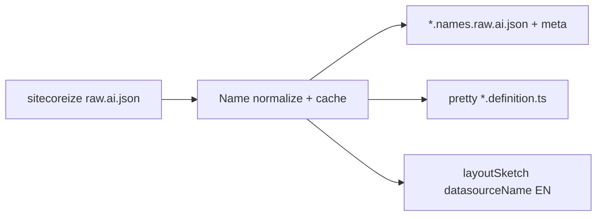

# Post-AI definition name normalize (HTML labels → EN Path)

## Problem (example)

[`menzis-image-content-section.definition.ts`](bq/src/components/menzis-nl/MenzisImageContentSection/menzis-image-content-section.definition.ts) keeps HTML-derived Dutch Path names under `culture: "nl-NL"`:

```ts
{ name: 'Anderzorg wordt Menzis', fields: { Heading: 'Anderzorg wordt Menzis', … } }
```

AI-invented identities (`Image Content Sections`, template names) are already English. Sitecoreize `layoutSketch` also points at those Dutch labels via `datasourceName` (e.g. `"Wel verzekerd bij Menzis"` in the section-04 raw dump) — those must track the translated Path or page wiring breaks.

## Rule

| Kind | After normalize | Example |
| --- | --- | --- |
| **AI-invented identity** (already English) | Leave | folder / template / componentName |
| **HTML-derived Path candidate** | `name` → EN (cache); `displayName` → original | `Persoonlijk contact` → name EN + displayName Dutch |
| **layoutSketch / page `datasourceName` / `datasourceItem`** | Same EN string as the item `name` map | sketch + pages stay aligned |
| **Field values / field names** | Unchanged | Heading text Dutch; field keys already EN |

### Stability

Same HTML label → same translation-cache hit → same English Path on reruns (AI may re-copy Dutch into `name`; normalize makes Path stable).

### TSX compatibility

No field-contract break: TSX already binds English field names. Path/`datasourceName` is the coupling to keep in sync (not TSX props).



## Normalize scope

Heuristic: not already English → HTML-derived Path label; already English → AI identity, skip.

Rewrite:

1. `content.items[].name` (+ nested children) → EN `name`, set `displayName` to prior name when missing
2. Matching strings in **`layoutSketch` `datasourceName`** (all placeholder trees) via the same before→after map
3. Downstream page `datasourceItem` from that sketch / same map (write order: normalize packages+sketch first, then page wireup consumes EN names)

Do not rewrite field seed values or English AI identities.

## Evidence dump (ai-debug)

Under the section `ai-debug/` next to the sitecoreize dump (e.g. section-04):

- Keep existing `codegen-sitecoreize-….raw.ai.json` (pre-normalize AI output)
- When any name remap happened, also write:
  - `{stem}.names.raw.ai.json` — full sitecoreize JSON **after** name normalize (packages + layoutSketch), pretty-printed
  - `{stem}.ai-names.meta.json` — machine-readable remaps: `{ kind, before, after, displayName?, cacheHit? }`
  - **`{stem}.ai-names.log`** — dedicated human-readable log of **what was translated**, one entry per remap, e.g.:
    ```
    [item-name] "Persoonlijk contact" → "Personal Contact" (displayName kept)
    [datasourceName] "Wel verzekerd bij Menzis" → "Well Insured With Menzis"
    [item-name] "Medicijntekorten" → "Medicine Shortages" (cache hit)
    ```
    Include culture (`nl-NL→en`), purpose, and whether it was cache hit vs AI. Easy to open next to the raw dump without parsing JSON.

Same stem as sitecoreize (`codegen-sitecoreize-{Component}`). No write when nothing changed.

## Pretty definition write

When writing [`*.definition.ts`](bq/src/components/menzis-nl/MenzisImageContentSection/menzis-image-content-section.definition.ts), emit readable formatting (multi-line, consistent indent) — not the current minified one-liner style. Reuse whatever formatter the write path already has (Prettier / existing pretty helper); if none, add a small format step on write only.

## Emit safety net

[`resolveEnglishItemName`](bq/tools/shared/english-item-name.ts): already English → no AI; leftover Dutch → still EN Path. DisplayName from `displayName` / Heading for source culture.

## Prompt (light)

Document AI English identities vs HTML-derived labels; tooling EN-normalizes Path + remaps sketch datasource names.

## Tests

- Dutch item names → EN name + displayName original; fields unchanged
- layoutSketch `datasourceName` remapped with same map as item names
- Already-English names untouched; 0 AI
- Definition write is pretty-formatted
- ai-debug names dump + meta when remaps occur; no-op when none
- Emit skip for already-EN Path

## Out of scope

- Translating field **values** in this pass
- Forcing AI never to copy HTML into `items[].name`
